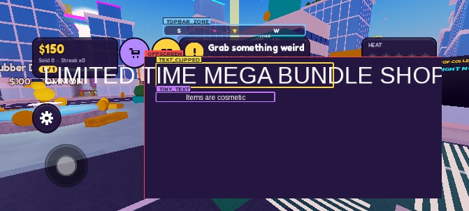
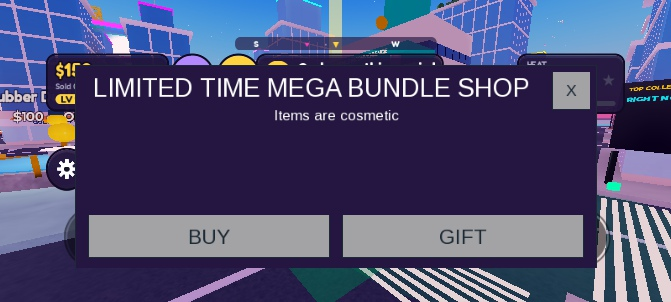

# Mobile UI Audit (Roblox Studio plugin)

One click in Roblox Studio shows the UI problems your **phone players** hit: buttons too small to tap, text that is cut off, panels hiding under the top bar or past the screen edge.

## Before and after on a phone (Galaxy A06)

| Before: 5 problems | After the fix: 0 problems |
|---|---|
|  |  |

**Free phone check for the first 5 games:** send one screen of your game and get its top 3 phone problems back within 48 h. No payment, no email.

**[Request a free phone check](https://github.com/schluetergerrit3007-blip/mobile-ui-audit/issues/new?title=Request%3A%20free%20phone%20check&body=Game%20link%20plus%20a%20phone%20screenshot%20of%20the%20screen%20(or%20an%20.rbxl)%3A%0AWhich%20screen%20annoys%20phone%20players%20most%20(shop%2C%20HUD%2C%20menu)%3A%0AWould%20you%20pay%20%2449%20to%20have%20the%20findings%20fixed%3F%20(yes%20%2F%20maybe%20%2F%20no)%3A)**

**Real result on a real game** (Samsung Galaxy A06 in the Device Simulator):

```
1 issue(s)
[TOPBAR_ZONE] BRB_HUD.Compass · reaches 14 px into the top bar: fine only where Roblox shows no buttons
```

The compass reaches 14 px into the top bar. Full example: [sample report](docs/sample-report.md).

## Checks
| Label | Finds |
|---|---|
| `OFFSCREEN` | visible elements crossing the screen edge or under the top bar |
| `SMALL_TARGET` | buttons smaller than 44 × 44 px |
| `TEXT_CLIPPED` | text that does not fit its box |
| `TINY_TEXT` | text under 11 px |
| `TARGET_OVERLAP` | buttons covering each other |

Toolbar buttons:
- **Audit**: red outline and label on each finding, plus a list in the Output.
- **Next phone**: cycles the Device Simulator through Galaxy A06, iPhone 16, iPad, then off.
- **Clear**: removes the outlines.

Works in Edit mode (StarterGui) and in Play mode (your live PlayerGui, including UI created by scripts).

It only reads: your UI is never changed. Empty layout frames and Roblox's own touch controls are skipped, so only real problems show up.

## Get your game checked (service)
We run the audit on **your** game on three devices (small Android phone, iPhone, iPad) and send you the results.

| Package | You get | Price |
|---|---|---|
| **Audit report** | All findings with element paths, a screenshot per device, a prioritised fix list | **$19** |
| **Audit + fixes** | The report, plus we fix the findings in a copy of your place (Scale/UISizeConstraint/TextScaled, larger touch targets) and send it back | **$49** |

**How to order:** open an issue titled **"Order: audit"** with your game link (or a .rbxl file) and the package. We reply within 24 h with the delivery date and payment details. You pay only after we confirm.

## Plugin
**$4.99** one-time, planned for the Roblox Creator Store, **not on sale yet**. Want it? Give a 👍 on [issue #1](../../issues/1). That is how we count interest.
